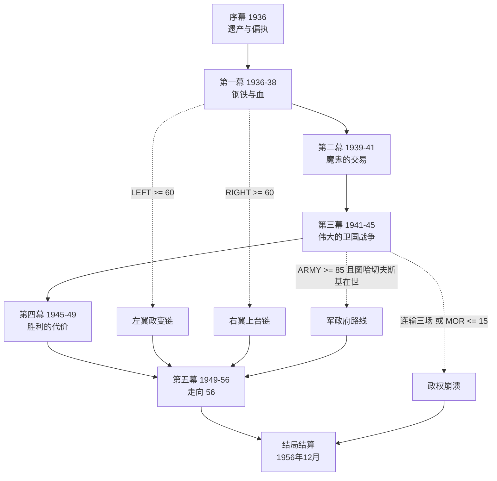

# 《56之路：苏维埃》—— 苏联国策 RPG 设计文档

> 基于《钢铁雄心4》Road to 56 mod 的苏联国策树与核心决议
> 时间跨度 1936.1 – 1956.12 ｜ 五幕 ｜ 约 40 个抉择 ｜ 16 种结局

---

## 0. 一句话

你从 1936 年 1 月开始执掌苏联，用二十年、四十个抉择，把「五年计划 — 大清洗 — 卫国战争 — 冷战」这条路走完；1956 年 12 月，历史会替你结算你究竟是个什么样的统治者。

---

## 1. 设计定位

**类型**：文本驱动 + 数值结算的国策模拟 RPG（单人，无战斗操作，全部决策通过"焦点槽"完成）

**单周目时长**：30–45 分钟

**取材**：
- Road to 56 苏联国策树（把时间轴延伸到 1956 年）
- No Step Back 的**偏执（Paranoia）**机制 —— 原版苏联树的核心张力
- 苏联核心决议：大清洗、集体化、斯大林防线 / 莫洛托夫防线、工业东迁、租借法案、敌后游击、原子弹工程
- 苏联树的三条政治分叉：The Centre（斯大林）/ The Left Opposition（托洛茨基）/ The Right Opposition（布哈林）

**三条设计铁律**：

1. **不存在"全对"路线。** 国策树上的互斥分支在游戏里就是互斥选项，每个选项都写死代价。
2. **数值不是装饰。** 结局由属性判定，不由剧情钦定。走同一条政治路线、打不同的仗，1956 年会完全不同。
3. **历史是默认值，不是命运。** 默认走法会得到接近真实历史的 1956 年；任何一条分叉都能把它彻底改写。

---

## 2. 玩家角色与时间轴

玩家扮演**国家意志本身**——没有姓名、没有面孔的苏联国家机器。文本中不出现「你作为斯大林」这类人格化视角，所有抉择以「国家机器做出决定」的口吻呈现；斯大林只是这台机器上最大的那个零件，他会死，机器不会。

第四幕末，人格化的核心（斯大林）消失，第五幕由同一股国家意志继续做出选择——而它此时必须回答一个问题：**没有那个人的话，它是什么？**

| 幕 | 年份 | 主题 | 主要对应国策群 |
|---|---|---|---|
| 序幕 | 1936 | 遗产与偏执 | The Stalin Constitution / The Centre |
| 第一幕 | 1936–38 | 钢铁与血 | 五年计划 / 集体化 / The Great Purge / 军队改革 |
| 第二幕 | 1939–41 | 魔鬼的交易 | 集体安全 / Approach Germany / 冬季战争 / 防线 |
| 第三幕 | 1941–45 | 伟大的卫国战争 | 战役链 / 工业东迁 / 租借 / 游击战 |
| 第四幕 | 1945–49 | 胜利的代价 | COMECON / 华约 / 原子弹 / 冷战开局 |
| 第五幕 | 1949–56 | 走向 56 | 继承人战争 / 去斯大林化 / 1956 |

---

## 3. 核心系统

### 3.1 六项资源

| 属性 | 记号 | 范围 | 说明 |
|---|---|---|---|
| 政治资本 | `PP` | 0–999 | 推行决议与政治操作的通货，每幕自动回复 |
| 偏执 | `PAR` | 0–100 | 斯大林的疑心。**本作核心张力** |
| 工业 | `IND` | 0–300 | 工厂等效值。决定红军规模、防线、核项目 |
| 红军 | `ARMY` | 0–100 | 军队战力。受清洗、学说、政治委员影响 |
| 民心 | `MOR` | 0–100 | 稳定度与战争支持度合一 |
| 阵营影响 | `COM` | 0–100 | 共产国际 / 社会主义阵营的国际影响力 |

### 3.2 偏执系统（Paranoia）

偏执是本作唯一一个"你越用力越糟"的属性。

**上升来源**：示强类国策、外部背叛（盟约破裂、盟友倒戈）、战败、敌方间谍渗透
**下降来源**：主动清洗（花 PP + 永久损失人才）、放权、大赦、反个人崇拜

**阈值行为**：

| 阈值 | 触发 |
|---|---|
| ≥ 50 | 内务部开始自行其是，随机小事件（"又一位同志被捕了"） |
| ≥ 75 | **每次幕间结算**触发一次随机清洗，从「军官 / 老布尔什维克 / 科学家 / 内务部」中随机砍掉一项 |
| ≥ 90 | 每幕一次**暗杀判定**。失败则提前进入「无声的独裁」结局，游戏直接跳到 1956 |

**全作最重要的取舍就在这里**：清洗能立刻把偏执压下去，但你砍掉的正是 1941 年打赢巴巴罗萨的资本。玩家必须在"现在安全"和"三年后活着"之间做反复选择。

**两个配套机制**：

- **叶若夫 / 贝利亚二选一**（第一幕）：叶若夫=清洗效率高、PP 消耗大、连带伤害不可控；贝利亚=精准（可点选清洗目标）、偏执降幅小，但**贝利亚自身势力会增长**，第四幕可反噬。
- **「Lessons of War」**：若在卫国战争中吃过一次"失守"，解锁该决议，一次性清除「大清洗」debuff 的一半（对应原版国策：用战场教训换取军官团重获信任）。

### 3.3 三派天平

| 派系 | 代号 | 代表 |
|---|---|---|
| 斯大林派 | `STAL` | 斯大林、莫洛托夫、卡冈诺维奇、伏罗希洛夫 |
| 左翼 | `LEFT` | 托洛茨基、季诺维也夫、加米涅夫、斯米尔诺夫 |
| 右翼 | `RIGHT` | 布哈林、李可夫、托姆斯基 |

初始值 `60 / 25 / 25`。多数"中央"国策给 `STAL +3`；分叉国策给左或右，且互斥。

**触发条件**：

- `LEFT ≥ 60` 且（`PAR ≥ 80` 或 战争失利）→ **左翼政变链**（The Military Conspiracy → Coup d'état）
- `RIGHT ≥ 60` 且 `MOR ≤ 35` → **右翼上台链**（Back to the NEP）
- `ARMY ≥ 85` 且图哈切夫斯基存活 → 第三幕末触发 **军政府路线** 分支（红色拿破仑）

任意一派 `≥ 60` 且存活到第五幕，解锁该路线的专属结局。

### 3.4 焦点槽与回合

全作约 **40 个焦点槽**，每槽 = 一个抉择（2–4 个互斥选项）。

槽位之间不严格线性：部分国策需要前置标记才能出现。例如「冬季战争」需要先有「苏德条约」或「波罗的海通牒」；「纵深作战学说」需要图哈切夫斯基存活。

**每幕结束 = 结算**：属性变化 → 派系变化 → 幕末判定 → 可能进入分支幕。

### 3.5 战役判定公式

第三幕的战争是一个连续判定链。单场战役：

```
战力比 R = (红军 × 工事系数 × 民心系数) ÷ (敌军强度 × 预警系数)

工事系数 = 1 + min(防线值, 48) / 160        → 1.00 – 1.30
民心系数 = 0.65 + 民心 / 200                → 0.80 – 1.15
预警系数 = 1.00（无预警） / 0.85（部分预警） / 0.70（完整预警）
敌军强度 = 德国基础值（随年份下降）
```

预警系数作用在**分母**上——完整预警把德军的有效强度压到 70%。这是第二幕外交抉择真正的价值所在。

| R | 结果 | 后果 |
|---|---|---|
| < 0.4 | **崩溃** | 红军 −8，民心 −18，计入崩溃次数 |
| 0.4 – 0.7 | **失守** | 红军 −4，民心 −8，解锁「战争教训」决议 |
| 0.7 – 1.0 | **僵持** | 民心 −3，战局拖长 |
| 1.0 – 1.35 | **守住** | 红军 +2，民心 +5 |
| ≥ 1.35 | **反攻** | 红军 +5，民心 +10，计入反攻次数 |

**战时动员底线**：1941–1945 年间，每进入一个新场景，红军战力会被抬升到一个随时间递增的下限（36 → 60）。这代表后方新组建的师源源不断补充到前线——它保证了任何路线都不会因为早期的一次崩溃而彻底失去翻盘可能，同时也让「你前期攒下的防线和民心」成为真正的胜负手。

> 设计校验：在同一套敌军参数下，"不作任何决议 + 全选最激进选项"会打出崩溃 2 次、失守 4 次的**惨胜**；"全程防御性选择 + 合理分配决议"会打出 6 次守住、5 次反攻的**伟大胜利**；两者之间的差异完全来自玩家的选择，而不是随机数。


---

## 4. 核心决议表

决议不消耗回合，只消耗资源。**绝大多数决议消耗政治资本**——工业（IND）在实现里被当作结构性国力，不会被决议花掉，这样它在结局报告里始终是一个可信的读数。

| 决议 | 消耗 | 效果 | 次数上限 |
|---|---|---|---|
| 清洗军队 | PP 30 | 红军 −5，偏执 −10，民心 −3 | 3 |
| 清洗党 | PP 25 | 斯大林派 +3，左翼 −4，右翼 −4，偏执 −8 | 4 |
| 清洗内务部 | PP 40 | 偏执 −15，民心 −2 | 2 |
| 集体化推进 | PP 20 | 工业 +8，民心 −6 | 2 |
| 修建**斯大林防线** | PP 25 | 旧边界防线 +8 | 3 |
| 修建**莫洛托夫防线** | PP 30 | 新边界防线 +8 | 3 |
| 扩产坦克 | PP 25 | 红军 +6 | 3 |
| 工业东迁 | PP 40 | 战时工业保全 +25% | 2 |
| 请求租借法案物资 | PP 25 | 工业 +10，民心 +4，阵营 −5 | 3 |
| 组织敌后游击 | PP 20 | 敌军强度 −8 | 3 |
| 战争教训 · 恢复军官团 | PP 40 | 红军 +12，偏执 +5（需吃过一次失守） | 2 |
| 动员征兵 | PP 25 | 红军 +7，民心 −5 | 3 |
| 宗教和解 | PP 15 | 民心 +3，宗教值 +1（通向「第三罗马」隐线） | 3 |
| 无神论宣传 | PP 15 | 民心 +5，偏执 −3 | 2 |
| 大赦 | PP 25 | 民心 +8，偏执 −10，斯大林派 −5 | 1 |
| 战后重建 | PP 30 | 民心 +10，工业 +6 | 3 |
| 扩大阵营 | PP 30 | 阵营影响 +12，民心 −3 | 3 |
| 氢弹工程 | **工业 30** | 核进度 +30（唯一真正烧工业的决议） | 2 |
| 消费品生产 | 工业 25 | 民心 +12，工业 +5 | 2 |
| 民族迁移 | PP 30 | 民心 −8，偏执 −8，民族问题 +15 | 2 |
| 反个人崇拜 | PP 40 | 偏执 −25，斯大林派 −15，民心 +5 | 1（仅第五幕） |

> **总的约束在政治资本上**：全作约 450 点 PP 收入，而上面 21 条决议平均 28 点一次——你大约只能执行 15 次。这是在序幕就要开始做的预算。
>
> **莫洛托夫防线是精心设计的陷阱**：它给新边界（1939 吞并的波兰东部、波罗的海）修工事，但如果三次投入没有投满，这些工事**一点用都没有**——因为红军的仓库和铁路全在旧边界线上。玩家要么老实修斯大林防线，要么承担"两边都不够"的风险。这直接对应原版苏联树里这条线的取舍。


---

## 5. 全局流程图



---

## 6. 序幕 · 1936：遗产与偏执

**简报**

> 基洛夫死了。第一个五年计划刚刚宣布提前完成——官方数字漂亮得没人敢怀疑。重工业从零长到欧洲第一，代价是农村的沉默和古拉格里的名字。
>
> 你面前有三份文件。第一份是内务部送来的反对派名单，左翼一个纵队，右翼一个纵队。第二份是第二个五年计划的草案。第三份是那份还没通过的宪法草案——它会把"苏联最高苏维埃"写进纸上，也会把清洗写进法理。

### 抉择 0-1「如何对待反对派？」〔定调抉择］

| 选项 | 效果 | 标记 |
|---|---|---|
| **A. 铁腕 —— 「他们将被知道恐惧」** | PAR +20，LEFT −40，RIGHT −30，ARMY −15，IND −5，MOR −5；获得「恐惧」：前两幕稳定度下限 +10 | `purge_start = true` |
| **B. 分化 —— 拉一派打一派** | PP +50，PAR +5；立刻选择拉拢左翼（LEFT +20，RIGHT −15）或右翼（RIGHT +20，LEFT −15） | `divide = left/right` |
| **C. 容忍 —— 「言论自由是统一的前提」** | PAR −10，LEFT +15，RIGHT +15，MOR −10，STAL −10；解锁后续「人民革命」和解线 | `tolerance = true` |

> 选 C 的玩家会在第一幕很舒服，第二幕开始难受——因为斯大林派人多，但你亲手把天平放平了。

### 抉择 0-2「第二个五年计划的方向」

| 选项 | 效果 |
|---|---|
| **A. 重工业优先**（Heavy Industry / Third Five Year Plan） | IND +40，MOR −12，ARMY +5 |
| **B. 民生优先**（Social Welfare / Mass Immunizations / Education Initiative —— R56 社会线） | MOR +18，IND +10，ARMY −3 |
| **C. 军工优先**（Shift To Armaments Production / Optimize Production Lines） | ARMY +15，IND +15，MOR −8 |
| **D. 分散均衡**（National Specialists / Foreign Experts） | IND +22，MOR −2，额外 PP +30 |

### 抉择 0-3「斯大林宪法」

| 选项 | 效果 | 后果 |
|---|---|---|
| **A. 通过**（The Stalin Constitution） | PP +60，MOR +10，STAL +10 | 清洗获得法理工具：后续每次「清洗党」「清洗军队」的 PP 消耗 −5 |
| **B. 推迟** | PAR +15，MOR −8 | 保留灵活性；第二幕可提出「Article 124」变体，为宗教/第三罗马线留门 |

**序幕结算**：确定初始 `PAR`，写入标记 `purge_start` / `divide` / `tolerance`。若选 C（容忍）且第一幕仍大量清洗，则触发独有事件「同志的失望」，LEFT +25。

---

## 7. 第一幕 · 1936–1938：钢铁与血

**主题国策群**：五年计划（重工业、合成橡胶、石油、钢铁铸造）｜集体化 ｜The Great Purge（The Military Conspiracy / The Bloc of Rights and Trotskyites / Behead the Snake）｜军队改革（Restore Cossack Units / Military Reorganization）｜宣传（Stalin's Cult of Personality / They will Know Fear）｜科研（The USSR Academy of Sciences / Soviet Atomic Bomb Project）

### 抉择 1-1「图哈切夫斯基案」（1937）★核心抉择

情报部门递上来一份伪造的德军文件，说红军元帅们正在策划政变。你知道文件是假的。问题是：**你是想让它是真的，还是想让它是假的？**

| 选项 | 效果 | 长期后果 |
|---|---|---|
| **A. 批准清洗军方高层**（The Military Conspiracy） | ARMY −30，PAR −15，STAL +8；图哈切夫斯基、乌博列维奇、叶戈罗夫、布柳赫尔死亡 | 清除军内政治威胁；**永久锁死「纵深作战」学说线**；1941 巴巴罗萨敌军强度 +15 |
| **B. 保住图哈切夫斯基** | PAR +25，ARMY +15，STAL −10，LEFT +5 | 解锁「Approach Tukhachevsky」→ **纵深作战（Deep Battle）/ 大机械化** 学说线；埋下「红色拿破仑」隐患：`napoleon = true` |
| **C. 拖延与部分清洗** | PAR +12，ARMY −10，随机失去 1–2 名元帅 | 折中；`napoleon = false`，但也拿不到完整学说线 |

> 这是全作分歧最大的一刀。选 A 的玩家会得到一个听话的红军和一场极为艰难的 1941；选 B 的玩家会得到一支能打纵深作战的红军，但第三幕末要面对一场军事政变的可能。

### 抉择 1-2「集体化的代价」（1937–38）

| 选项 | 效果 | 后果 |
|---|---|---|
| **A. 全速集体化**（The Collectivization） | IND +20，MOR −25，RIGHT −20 | 触发事件「大饥荒」（1938）：MOR −10，若此时 MOR ≤ 30 则额外触发「乌克兰动荡」，LEFT −10 |
| **B. 有节制的集体化** | IND +10，MOR −10，RIGHT +5 | 无饥荒事件 |
| **C. 退让 —— 让农民留下土地** | IND +5，MOR +12，RIGHT +25，PAR +15 | 推进右翼路线；若 RIGHT ≥ 60，第二幕触发「Dissent in the Party」 |

### 抉择 1-3「叶若夫还是贝利亚」（1938）

| 选项 | 效果 |
|---|---|
| **A. 让叶若夫继续** | PAR +20，清洗决议 PP 消耗 −10；NKVD 势力 +30；每幕额外随机清洗 1 次 |
| **B. 换上贝利亚** | PAR −10，NKVD 势力 +15；解锁**定向清洗**（可点选清洗"军队/党/知识分子"中的一项，附带伤害减半）；`beria_power = 15` |
| **C. 清算叶若夫** | PAR −20，MOR −10，NKVD 势力 −20；`beria_power = 0`，第三幕无贝利亚可用 |

> `beria_power` 是第四幕的伏笔：若贝利亚势力 ≥ 40，第五幕解锁「贝利亚的技术官僚改革」路线，同时解锁「贝利亚反噬」风险。

### 抉择 1-4「原子弹计划」（1938）

| 选项 | 效果 |
|---|---|
| **A. 全力投入**（Soviet Atomic Bomb Project） | IND −30，核进度 +50；1949 年试爆 |
| **B. 小规模研究** | IND −10，核进度 +15；1953 年试爆 |
| **C. 暂缓** | IND +10；第四幕面临美国核垄断，`nuclear = none` |

### 抉择 1-5「军队的形态」

| 选项 | 效果 | 前置 |
|---|---|---|
| **A. 纵深作战学说**（Deep Battle） | ARMY +20（分三年到账），解锁「大机械化」 | 需 `napoleon = true` |
| **B. 恢复政治委员制度**（Keep Commissars） | ARMY −10，STAL +15，PAR −10 | 无 |
| **C. 恢复哥萨克部队**（Restore Cossack Units） | ARMY +8，MOR +8 | 无 |
| **D. 大规模炮兵主义**（Soviet Artillery / PC of Mortar Armament） | ARMY +12，IND −10 | 需第一幕选过「军工优先」 |

**第一幕结算**：
- 若 `PAR ≥ 75`，触发随机清洗一次
- 若 `ARMY ≤ 40`，标记 `weak_army = true`（第二幕冬季战争与第三幕首战受罚）
- 若 `LEFT` 或 `RIGHT ≥ 55`，标记 `unrest = true`

---

## 8. 第二幕 · 1939–1941：魔鬼的交易

**简报**

> 1939 年 8 月。希特勒的使节在莫斯科等回话，英法的军事代表团还在船上。你有三条路：和西方结盟、和德国做一笔生意、或者谁也不靠，独自把墙砌高。

### 抉择 2-1「1939 年的选择」★★全局最大分叉

| 选项 | 效果 | 战争时间线 |
|---|---|---|
| **A. 与德国签约**（Approach Germany / 莫洛托夫-里宾特洛甫） | IND +25，COM −30，MOR −5；获得东波兰、波罗的海、比萨拉比亚的法理；`war_year = 1941` | 1941 年 6 月巴巴罗萨，**无预警**（预警系数 1.0），突袭加成 +15 |
| **B. 集体安全**（Policy of Collective Security / Seek a Defense Pact） | COM +25，IND +10，MOR +5 | 需 `外交信誉 ≥ 50`（清洗越多、信誉越低）。成功：1939 无东线战争，`war_year = 1942`，预警系数 0.7；失败：英法拖延，`war_year = 1941`，且无领土收益 |
| **C. 共产国际输出革命**（The Comintern / Ignite the Flames） | COM +40，LEFT +25，IND −10，外交信誉 −30 | 需 `LEFT ≥ 50`。支援西班牙与中国；1939 德国先打西方，`war_year = 1942`，但**西方不会援助你**（租借法案需 COM 换汇，成本翻倍） |
| **D. 单独安全**（Policy of Individual Security） | IND −20（转为工事），防线 +20，PAR −10 | 不结盟。`war_year = 1941`，预警系数 0.8，但无条约义务、无领土 |

> **A 是历史默认路线，也是数值上最舒服的**——领土、工业、时间都赚。代价是 COM 崩掉，第四幕的冷战开局会非常孤立（欧洲没人信你）。

### 抉择 2-2「冬季战争」（1939–40）

| 选项 | 效果 |
|---|---|
| **A. 全面入侵芬兰**（Secure Leningrad / 冬季战争） | 若 `ARMY ≥ 55`：惨胜，防线 +15，芬兰割地，但**敌军强度 +10**（德国看着红军在雪地里挣扎）；若 `ARMY < 55`：惨胜 + `weak_army` 强化，敌军强度 +25 |
| **B. 有限目标**（只要卡累利阿地峡） | IND −10，防线 +8，代价小；芬兰中立化，`finland_neutral = true` |
| **C. 外交解决** | COM +10，无领土；**列宁格勒不安全**：第三幕列宁格勒战役 R × 0.85 |
| **D. 全面吞并**（波罗的海模式） | 吞并芬兰，IND +15，COM −25，第三幕芬兰方向额外兵力牵制（敌军强度 +5） |

### 抉择 2-3「波罗的海与比萨拉比亚」

| 选项 | 效果 |
|---|---|
| **A. 最后通牒（三个月内解决）** | 一次吞并立陶宛、拉脱维亚、爱沙尼亚、比萨拉比亚；IND +20，防线 +10，MOR −5，**民族问题 +20**（第四幕的东欧动荡系数） |
| **B. 分阶段吞并** | IND +12，MOR +3，民族问题 +8；但需多花 1 个焦点槽 |
| **C. 「尊重波罗的海自决」**（Respect Baltic Self-...） | 不吞并，COM +15，外交信誉 +20；第三幕失去波罗的海缓冲区，预警系数 +0.1 |

### 抉择 2-4「军队整顿」

| 选项 | 效果 |
|---|---|
| **A. 恢复军官团**（Military Reorganization / First Rehabilitated Military） | ARMY +15，PAR +10；从古拉格放出军官 |
| **B. 强化政治控制** | STAL +12，PAR −12，ARMY −5 |
| **C. 惩戒营与屏障部队**（Penal Battalions / Barrier Troops / SMERSH） | ARMY +5，MOR −8，但第三幕"死守"类选项效果 +25% |
| **D. 战争教训**（Lessons of War，需第三幕才可用） | —— 留至第三幕 |

### 抉择 2-5「战争准备：工业的天平」（1940–41）★陷阱抉择

把有限的 IND 分配到四个方向，**总和不能超过当前 IND 的 40%**：

- **修斯大林防线**（旧边界）：每 15 IND 换 +10 防线
- **修莫洛托夫防线**（新边界）：每 20 IND 换 +12 防线 —— **但 1941.6 前未满 3 次投入，则全部作废**
- **扩产坦克**（Development of Tankograd / Merge Tank and Materiel）**：每 15 IND 换 ARMY +6
- **预投工业东迁**：每 20 IND 换"战时工业保全" +25%（最多 50%）

> 这是本作最精妙的一处设计：**你吞并的领土越多，你需要防守的线就越长，而你的工厂数没有变。**选 A 拿下半个东欧的玩家，会在这里第一次感到痛。

**第二幕结算**：写入 `war_year`、`预警系数`、`防线值`、`敌军强度修正`、`民族问题`、`beria_power`。1941 年 6 月 22 日（或 1942 年），战争爆发，进入第三幕。

---

## 9. 第三幕 · 1941–1945：伟大的卫国战争

**本幕结构**：一场首战 + 十一个战役/外交抉择，每个抉择都直接改写 §3.5 公式里的某一项。

**首战前统一结算**：

```
敌军强度 E = 100
  + 15（冬季战争表现差 / weak_army）
  + 10（图哈切夫斯基已死）
  - 10（完整预警，间谍网或条约情报）
  + 5（波罗的海缓冲区缺失）
```

### 抉择 3-1「边境战役」1941.6–9

| 选项 | 对公式的影响 | 代价 |
|---|---|---|
| **A. 死守 —— 「一步也不许后退」**（提前签发 Order 227） | 工事系数 ×1.15 | ARMY −15，MOR −12；若 R < 0.7 触发**大规模合围**（MOR 额外 −15） |
| **B. 弹性防御 / 纵深决战**〔需 `napoleon = true`〕 | 工事系数 ×1.0，但守住判定线降至 0.85 | ARMY −5，MOR −5；放弃白俄罗斯、乌克兰大部 |
| **C. 全线反击** | R −0.35 | 灾难性，几乎必然触发崩溃分支 |
| **D. 焦土撤离 + 就地东迁** | IND 保全 +25% | MOR −15，领土丢失更多 |

> 结果直接影响后续所有战役的 `ARMY` 起点。**选 A 的人会重演历史，选 B 的人会少死一百万人但丢掉半个国家——两条路都能赢，但赢得完全不同。**

### 抉择 3-2「列宁格勒」1941.9

| 选项 | 效果 |
|---|---|
| **A. 拉多加湖「生命之路」**（The Road of Life） | IND −10，守住，MOR +8，ARMY −3 |
| **B. 与工业共存亡 —— 不疏散平民** | IND 全额保留，MOR −15，触发「九百天」事件：巴黎/伦敦舆论转向（COM +5） |
| **C. 优先疏散** | MOR +6，IND −15 |
| **D. 放弃城市** | MOR −20，ARMY 保全；`leningrad_fallen = true`（第五幕惩罚） |

### 抉择 3-3「莫斯科」1941.10–12 ★标志性抉择

**前置抉择 3-3a：能否抽调远东师？**

| 选项 | 效果 |
|---|---|
| **A. 与日本签中立条约**（Soviet-Japanese Pact） | 抽调西伯利亚师：ARMY +15；COM −10 |
| **B. 相信情报（佐尔格）** | 需有间谍网：ARMY +12，PAR +5（"你居然信了一个德国人的报告"） |

**主抉择 3-3b：**

| 选项 | 效果 |
|---|---|
| **A. 斯大林留在莫斯科，红场阅兵** | MOR +20，PAR +10，STAL +15；若 R < 0.7，则触发「撤离的传闻」，MOR 反扣 15 |
| **B. 撤往古比雪夫** | MOR −18，PAR −8（务实），指挥链保全 |
| **C. 交由朱可夫全权指挥反攻** | ARMY +10，MOR +8，STAL −8；`zhukov_power += 20` |

### 抉择 3-4「工业东迁」（决议，可选）

见 §4 决议表。战时执行：`MOR −10` 换 `工业保全 +25%`（可与第二幕预投叠加至 50%）。

### 抉择 3-5「租借法案」1941–42

| 选项 | 效果 |
|---|---|
| **A. 请求租借** | IND +15，MOR +5，COM −8；需与西方关系 ≥ 阈值（选了 2-1A 的玩家门槛更高） |
| **B. 拒绝资本主义施舍** | MOR +6，LEFT +12，COM +5；IND 无增长，第三幕后半段敌军强度相对 +10 |
| **C. 以黄金和矿产支付** | IND +12，IND −8（资源外流）；`no_debt = true`（第四幕外交更独立） |

### 抉择 3-6「斯大林格勒」1942–43

| 选项 | 效果 |
|---|---|
| **A. 巷战死守 + 天王星合围**（朱可夫 / 华西列夫斯基方案） | R +0.25，胜利后 ARMY +15，MOR +15 |
| **B. 提前撤出城区保存兵力** | MOR −10，ARMY +5；反攻推迟一年，敌军强度 +10 |
| **C. 由铁木辛哥执行正面强攻** | R −0.15，ARMY −10（高伤亡） |

### 抉择 3-7「库尔斯克」1943

| 选项 | 效果 |
|---|---|
| **A. 依据情报提前构筑纵深防御**（需间谍网） | R +0.2，MOR +8 |
| **B. 抢先发动反攻** | R −0.2，但胜利后推进速度 +1 年 |
| **C. 全面后撤诱敌深入** | R +0.3，MOR −8，领土损失 |

### 抉择 3-8「敌后游击」（决议，可重复）

`PP 20` → 德军补给 −5%/次，占领区反抗 +。白俄罗斯铁路战（Rail War）在 1943 后触发额外事件。

### 抉择 3-9「第二战场的外交战」1942–44

| 选项 | 效果 |
|---|---|
| **A. 反复催促英美** | COM +10，第二战场 1944 按时开辟，敌军西线压力系数正常 |
| **B. 威胁单独媾和** | 第二战场提前至 1943（若成功，P 值 +0.2），但 COM −15，西方信任崩坏 |
| **C. 用共产国际在欧洲制造压力** | 需 `LEFT ≥ 50`：西欧罢工、意大利变局，敌军强度 −10；COM +15 |

### 抉择 3-10「巴格拉季昂」1944

| 选项 | 效果 |
|---|---|
| **A. 主攻中央集团军群**（历史方案） | R +0.2，推进至维斯瓦河 |
| **B. 主攻南线，抢先进入巴尔干** | 抢在英美前控制罗马尼亚、保加利亚；COM +15，但东欧民族问题 +15 |

### 抉择 3-11「华沙起义」1944 ★道德抉择

| 选项 | 效果 |
|---|---|
| **A. 援助波兰地下军（国家军）** | COM +10，MOR +8；波兰战后成为"半独立盟友"，第四幕东欧处理成本 − |
| **B. 坐视，扶持卢布林委员会** | 民族问题 +20，COM −10，MOR −8；东欧苏维埃化一路顺风 |
| **C. 有限接触，两边下注** | 折中：MOR −3，波兰第四幕成为持续不满的卫星国 |

### 抉择 3-12「柏林」1945

| 选项 | 效果 |
|---|---|
| **A. 全力抢在英美之前**（朱可夫 / 科涅夫竞赛） | ARMY −12，MOR +20，COM +20，`berlin_soviet = true` |
| **B. 有序推进，减少伤亡** | ARMY −4，MOR +10；柏林分区占领，COM +5 |
| **C. 让盟军先到** | MOR −10，COM −10；换取战后谈判中的"道德高地" |

### 抉择 3-13「战后秩序」（1945）

| 选项 | 效果 |
|---|---|
| **A. 苏维埃化东欧** | COM +20，民族问题 +25，第四幕卫星国动荡 + |
| **B. 「人民民主」过渡**（联合政府） | COM +5，民族问题 +5，第四幕东欧更稳（1948 无铁托式裂痕） |
| **C. 尊重「被解放欧洲宣言」，自由选举** | COM −15，MOR +5，西方信任 +30；**整条冷战线的走向随之改变** |

**第三幕结算**——决定第四幕的起点：

| 战争结果 | 条件 |
|---|---|
| **伟大胜利** | 守住莫斯科与斯大林格勒，且推进至柏林 |
| **惨胜** | 曾触发过一次"崩溃"，但最终推进至柏林；MOR −15 起始，人口/工业 −20% |
| **僵持和平** | 1945 年战线仍在 1941 边界附近；第四幕变为"喘息幕"，无冷战 |
| **战败** | 三次以上"崩溃"或 MOR ≤ 15；进入**「第二个布列斯特」**分支，直接跳第五幕 |

---

## 10. 第四幕 · 1945–1949：胜利的代价

**简报**

> 战争赢了。两千七百万人没有回来。现在你站在波茨坦，手里有两个东西：一支欧洲最强的陆军，和一个被打成废墟的国家。美国人已经有原子弹了。
>
> 军方问你：我们为什么而战？工人问你：房子在哪里？党问你：接下来是谁？

### 抉择 4-1「战后经济模式」★

| 选项 | 效果 |
|---|---|
| **A. 重工业与军工继续 —— 「No Time For Peace」** | IND +35，MOR −20，ARMY +10；第四幕无住房/消费品事件 |
| **B. 消费品与住房优先**（马林科夫路线） | MOR +25，IND +10，ARMY −8 |
| **C. 有限市场化改革**（柯西金式企业改革） | IND +20，MOR +8，STAL −10，RIGHT +15；长期（第五幕）额外 +20 IND |
| **D. 农业自由化**（Back to the NEP 倾向） | MOR +20，RIGHT +25，LEFT −15；若 RIGHT ≥ 60，触发右翼上台链 |

### 抉择 4-2「东欧模式」

| 选项 | 效果 |
|---|---|
| **A. 苏维埃化** | COM +20，民族问题 +20 |
| **B. 人民民主** | COM +8；1948 年**无苏南冲突**，铁托留下 |
| **C. 松散联邦** | COM −10，MOR +5；卫星国自行其是 |

### 抉择 4-3「核与威慑」

| 选项 | 效果 |
|---|---|
| **A. 完成试爆 + 启动氢弹**（1949） | IND −25，`nuclear = hbomb`；冷战裁量权 + |
| **B. 只做原子弹** | 1949 试爆，`nuclear = atomic` |
| **C. 援助中国核项目** | COM +20，IND −15，中苏同盟深化 |
| **D. 放弃核武，推动核裁军** | COM +25，西方信任 +20；冷战格局完全改写 |

### 抉择 4-4「冷战第一次危机：柏林封锁」（1948）

| 选项 | 效果 |
|---|---|
| **A. 封锁柏林** | COM +10，西方信任 −30；成功度取决于核进度与 IND |
| **B. 谈判解决** | 折中，MOR +3 |
| **C. 不封锁，转向马歇尔计划的反制（莫洛托夫计划）** | IND +15，COM +5，西方信任 −10 |

### 抉择 4-5「中国」（1949）

| 选项 | 效果 |
|---|---|
| **A. 全力支持中共** | COM +25，IND −10 |
| **B. 双面接触（与国民党也保持联系）** | COM −10，灵活性 + |
| **C. 观望** | 无变化；中苏同盟不成立 |

### 抉择 4-6「内部清算：列宁格勒案与医生阴谋」（1948–1953）

| 选项 | 效果 |
|---|---|
| **A. 继续清洗（日丹诺夫案 / 医生阴谋）** | PAR −15（泄压），ARMY −8，MOR −15，科学家/−（核进度 −20） |
| **B. 停止政治迫害** | PAR +10，MOR +12，STAL −12 |
| **C. 让贝利亚接管（若 `beria_power ≥ 40`）** | PAR −20，`beria_power += 25`；第五幕解锁贝利亚路线，也解锁贝利亚反噬 |

**第四幕结算**：写入 `cold_war_intensity`、`nuclear`、`east_europe_stability`、`beria_power`、`zhukov_power`。进入第五幕。

---

## 11. 第五幕 · 1949–1956：走向 56

**简报**

> 1953 年 3 月的一个夜里，别墅的电话没有响。或者它响了，但你没有接。
>
> 二十年来第一次，这个国家要面对一个问题：没有你的话，它是什么？

### 5.0 斯大林之死（1953.3）——自动判定

| 条件 | 结果 |
|---|---|
| `PAR ≥ 90` 且 累计清洗 ≥ 6 次 | **暗杀**：被内务部/医生/亲信之一提前结束。游戏直接跳 5-2，且你不能再选路线 |
| `napoleon = true` 且 `ARMY ≥ 85` 且 `zhukov_power ≥ 40` | **军事政变**：红色拿破仑路线强制开启 |
| `beria_power ≥ 65` | **贝利亚接管**：他先动手了。你扮演贝利亚继续 |
| 其余情况 | **自然死亡**：进入正常的继承人之战 |

### 抉择 5-1「继承人之战」★★

| 选项 | 路线 | 效果 |
|---|---|---|
| **A. 集体领导**（赫鲁晓夫 / 马林科夫） | 赫鲁晓夫式 | MOR +15，STAL −20，党内分裂 +10；解锁去斯大林化 |
| **B. 继续斯大林主义**（莫洛托夫 / 卡冈诺维奇） | 斯大林主义延续 | MOR −10，PAR +10，STAL +20；稳定但僵化 |
| **C. 贝利亚的技术官僚改革** | 贝利亚路线 | IND +20，MOR +8，PAR −25；但需 `beria_power ≥ 40`，且 1953 年后有一次「贝利亚被反噬」判定 |
| **D. 军人政治**（朱可夫） | 军政府 | ARMY +15，MOR +5，STAL −30；需 `zhukov_power ≥ 40` 或 `napoleon = true` |
| **E. 新市场社会主义**（布哈林派回归） | 右翼 | IND +25，MOR +15，意识形态 −；需 `RIGHT ≥ 60` |
| **F. 第四国际的苏联**（托洛茨基派或其继承者） | 左翼 | COM +30，MOR +10，LEFT ≥ 60；需 `LEFT ≥ 60` 且托洛茨基在世或已被平反 |
| **G. 还政于苏维埃** | 民主化 | 需序幕选过容忍 且 `MOR ≥ 70`：MOR +25，COM +15，党内分裂 +25，**唯一能通向「全权苏维埃」结局的选项** |

### 抉择 5-2「去斯大林化与否」（1956.2 二十大）

| 选项 | 效果 |
|---|---|
| **A. 全面批判 —— 秘密报告** | MOR +20，STAL −30，阵营震荡 +30；触发 1956 匈牙利/波兰危机 |
| **B. 有限批判 —— 「个人崇拜的某些方面」** | MOR +8，阵营震荡 +10 |
| **C. 不予批判** | MOR −12，但阵营稳定；历史评价走向「钢铁的永恒」 |

### 抉择 5-3「1956：匈牙利与波兰」★

| 选项 | 效果 |
|---|---|
| **A. 军事干预（布达佩斯）** | COM +15，阵营震荡 −20，西方信任 −25，MOR −10 |
| **B. 政治解决，撤军** | COM −15，阵营震荡 +10，MOR +8；社会主义阵营开始多元化 |
| **C. 谈判 + 经济让利（COMECON 扩大）** | COM +8，IND −10；若 `IND ≥ 220` 则成功，否则被视为软弱 |

### 抉择 5-4「你的遗产」（1956.12 最终抉择）

最后一次分配：把剩余的 `IND` 和 `MOR` 投入三个方向之一——

- **军备与威慑** → 强化"冷战对峙"结局
- **民生与住房** → 强化"内部繁荣"结局
- **世界革命 / 阵营扩张** → 强化"社会主义阵营"结局

**结算**：进入结局判定。

---

## 12. 结局体系

结局由四个变量决定：**路线** × **战争结果** × **冷战形态** × **偏执遗产**。

实现形态是**「1 个主结局 + 若干叠加修饰」**：主结局由判定优先级选出（灾难类 → 特殊类 → 七条路线），战争结果与冷战选择则以「此前二十年留下了什么」的形式列在结局页上。这样 13 个主结局 × 战争/冷战修饰，组合出来的 1956 年是远超 16 种的不同面貌。

判定优先级（从上往下，第一个命中即为主结局）：

```
苏维埃的黄昏  ← 崩溃 ≥ 3 次，或民心 ≤ 15
第三罗马      ← 战败 + 宗教和解 ≥ 2 次 + 民心 ≤ 35
孤岛          ← 阵营影响 ≤ 20 且民族问题 ≥ 50
缓和          ← 放弃核武 且 西方信任 ≥ 20
共同经济体    ← 建立经互会 且 工业 ≥ 190
钢铁的永恒    ← 被暗杀，或路线为斯大林主义且偏执 ≥ 80
── 以下按第五幕「继承人之战」的路线分支 ──
伟大的继承人 / 技术官僚的秩序 / 红色拿破仑 / 新经济道路 / 永久的革命 / 全权苏维埃 / 无声的独裁
平庸的延续    ← 兜底
```


### 12.1 路线结局（七主结局）

| # | 结局 | 触发条件 | 1956 年 12 月的画面 |
|---|---|---|---|
| 1 | **钢铁的永恒** | 5-1B（斯大林主义延续）且 `PAR ≥ 80` 且 5-2C | 画像还挂在那里。你知道自己活不过下一个冬天，但没人敢说。国家在你身后冻住了 |
| 2 | **伟大的继承人** | 5-1A + 5-2A + 伟大胜利 | 秘密报告念完的那一刻，大厅里有人晕倒。但你还活着，并且门开着 |
| 3 | **技术官僚的秩序** | 5-1C 且通过反噬判定 | 秘密警察的档案柜换成了规划委员会的图表。效率提高了，问题是没有人在乎你怎么想 |
| 4 | **红色拿破仑** | 5-1D 或政变 | 军装走进了克里姆林宫。勋章代替了意识形态，地图代替了纲领 |
| 5 | **新经济道路** | 5-1E（右翼 ≥ 60） | 市场回来了，富农的孙子成了拖拉机厂的经理。老布尔什维克在角落里沉默 |
| 6 | **永久的革命** | 5-1F（左翼 ≥ 60） | 第四国际的旗帜在亚洲和非洲飘起来。你不再是一个国家，你是一场运动 |
| 7 | **全权苏维埃** | 5-1G + `MOR ≥ 70` | 最高苏维埃第一次真正投票。你输掉了那次表决，并且接受了结果 |

### 12.2 战争结果结局（三种，可与任意路线叠加）

| # | 结局 | 触发条件 | 画面 |
|---|---|---|---|
| 8 | **灰烬上的胜利** | 曾触发"崩溃"但最终推进至柏林 | 赢了。每四个苏联人里少了一个。没人笑得出来 |
| 9 | **第二个布列斯特** | 第三幕战败 | 1945 年在布列斯特-立托夫斯克签的字，和 1918 年那份几乎一样 |
| 10 | **僵持和平** | 第三幕结局为"僵持和平" | 没有人胜利，也没有人和解。边境线上还埋着 1941 年的尸体 |

### 12.3 特殊/隐线结局（六种）

| # | 结局 | 实现中的触发条件 | 画面 |
|---|---|---|---|
| 11 | **苏维埃的黄昏** | 崩溃 ≥ 3 次，或 `民心 ≤ 15` 且非战败 | 联盟开始一块块掉下来。波罗的海、高加索、中亚 |
| 12 | **第三罗马** | 战败 + 宗教和解 ≥ 2 次 + `民心 ≤ 35` | 诸圣大教堂重新点亮。一个自称来自旧王朝的人在莫斯科加冕，称这是"恢复" |
| 13 | **孤岛** | `阵营影响 ≤ 20` 且 `民族问题 ≥ 50` | 没有人愿意来莫斯科了。盟友是负担，邻国是威胁 |
| 14 | **缓和** | 第四幕放弃核武 且 `西方信任 ≥ 20` | 两个阵营在维也纳和日内瓦反复开会，而不是在柏林和布达佩斯 |
| 15 | **共同经济体** | 建立经互会 且 `工业 ≥ 190` | 统一电网、统一轨距、统一计价单位。经互会的卡车开到了伏尔加河边的新城 |
| 16 | **钢铁的永恒 / 无声的独裁 / 平庸的延续** | 同一区间的三种偏执遗产：被暗杀或偏执 ≥ 80 ／ 路线为斯大林主义但未去斯大林化 ／ 无明确路线 | 画像还挂在那里；或者，1956 年和 1936 年没有区别 |

> 注：结局页上还会列出「此前二十年留下了什么」——战争结果（从伏尔加河到易北河 / 灰烬上的胜利 / 第二个布列斯特 / 僵持和平）与冷战选择（核试爆 / 东欧选举 / 民族问题 / 工业东迁）作为叠加修饰条。这一栏才是让同一个主结局读起来完全不同的地方。


### 12.4 结局评级

结局结算时给出三行总结，对应 HOI4 的"战后报告"：

```
【工业】 IND 287 → 「欧洲第一、世界第二，但没有人愿意住在那里」
【代价】 人口 1.87 亿 → 「比 1936 年少了两千万，其中一半是你自己签署的」
【遗产】 「你留下的国家，会在 1991 年之前一直带着你的指纹」
```

---

## 13. 关键人物表

| 人物 | 阵营 | 作用 | 消失条件 |
|---|---|---|---|
| **斯大林** | 斯大林派 | 玩家本人（序幕–第四幕） | 第五幕 5.0 判定 |
| **莫洛托夫** | 斯大林派 | 外交。1939 条约、冷战谈判 | 第五幕可能被边缘化 |
| **卡冈诺维奇** | 斯大林派 | 工业与运输 | — |
| **伏罗希洛夫** | 斯大林派 | 军队（外行指挥） | 第三幕首战若崩溃 |
| **叶若夫** | NKVD | 1936–38 清洗引擎 | 1-3A 继续 / 1-3C 被清算 |
| **贝利亚** | NKVD | 定向清洗、技术官僚路线 | `beria_power` 决定他最后是盟友还是主角 |
| **图哈切夫斯基** | 军队 | 纵深作战学说；`napoleon` 隐患 | 1-1A 死亡 / 1-1B 存活 |
| **乌博列维奇 / 叶戈罗夫 / 布柳赫尔** | 军队 | 与图哈切夫斯基同命运 | 1-1A 连带死亡 |
| **朱可夫** | 军队 | 战役胜利、第五幕军人政治 | `zhukov_power` ≥ 40 解锁路线 |
| **华西列夫斯基 / 罗科索夫斯基** | 军队 | 反攻、巴格拉季昂 | 高 PAR 时可能被清洗 |
| **铁木辛哥** | 军队保守派 | 3-6C 的代价选项 | — |
| **季诺维也夫 / 加米涅夫** | 左翼 | 左翼路线核心 | 序幕 0-1A 或清洗 |
| **托洛茨基** | 左翼 | 「Behead the Snake」（1940 遇刺） | 若 LEFT ≥ 50 且未执行该决议，1940 后仍可能存活并回国 |
| **布哈林 / 李可夫 / 托姆斯基** | 右翼 | 右翼路线核心、NEP 复兴 | 清洗或 5-1E 复出 |
| **赫鲁晓夫 / 马林科夫 / 日丹诺夫** | 第五幕 | 继承人 | 5-1A 上台 |
| **柯西金** | 第五幕 | 经济改革派 | 4-1C 解锁顾问加成 |
| **铁托** | 外部 | 1948 苏南冲突 | 4-2B（人民民主）可避免 |

---

## 14. 随机事件表

**每幕自动触发 2–3 个，与玩家抉择无关，制造"历史不由你一人决定"的压迫感。**

| 年份 | 事件 | 效果 |
|---|---|---|
| 1936 | 基洛夫案余波 | PAR +5 |
| 1937 | 西班牙内战 | 支援（COM +10，LEFT +5）/ 不干涉（IND +5） |
| 1937 | 诺门罕冲突 | 小规模胜利：ARMY +3 |
| 1938 | 大饥荒（若全速集体化） | MOR −10 |
| 1939 | 苏日边境冲突扩大 | 若 `ARMY < 50`：ARMY −5 |
| 1940 | 托洛茨基遇刺 | LEFT −15；若未执行：LEFT +10，PAR +10 |
| 1941 | 珍珠港 → 美国参战 | 租借法案门槛 −20 |
| 1943 | 德黑兰会议 | 第二战场时间确定 |
| 1945 | 广岛 | 若 `nuclear = none`：COM −10，`atomic_gap = true` |
| 1946 | 铁幕演说 | 冷战强度 +15 |
| 1947 | 马歇尔计划 | 东欧国家动摇，民族问题 +5 |
| 1948 | 苏南冲突（若 4-2A） | COM −10，阵营震荡 +10 |
| 1949 | 新中国成立 | COM +15 |
| 1950 | 朝鲜战争 | 冷战胜负投注：介入（COM +10，MOR −5）/ 劝和（西方信任 +10） |
| 1953 | 斯大林之死 | 见 5.0 |
| 1956 | 苏伊士运河危机 | 与英法美的三角博弈 |

---

## 15. 数值平衡与难度

**难度档位**

| 档位 | 修正 | 目标玩家 |
|---|---|---|
| 历史 | 无修正 | 首次游玩 |
| 宽松 | `IND +30%`，决议消耗 −20% | 想体验剧情的玩家 |
| 铁人 | 所有负面数值 ×1.3，正面数值 ×0.85 | 想复刻"真实有多难"的玩家 |

**关键阈值（设计上的"生死线"）**

| 属性 | 阈值 | 意义 |
|---|---|---|
| `ARMY` | 55 | 冬季战争惨胜/可控的分界 |
| `ARMY` | 75 | 巴巴罗萨能守住的最低线（有完整防线时） |
| `ARMY` | 85 | 军政府路线解锁线 |
| `PAR` | 50 / 75 / 90 | 内务部自行其是 / 幕间随机清洗 / 暗杀判定 |
| `MOR` | 35 / 15 | 右翼上台线 / 政权崩溃线 |
| `LEFT`/`RIGHT` | 60 | 政变链与专属结局线 |
| `COM` | 20 / 90 | 「孤岛」/「半个世界」结局 |
| `民族问题` | 50 | 东欧动荡线 |

**平衡保证**

1. **任何路线都能打赢二战**——但代价曲线完全不同。斯大林主义路线用人和时间换空间；托洛茨基路线用外交孤立换意识形态扩张；右翼路线用军事弱换经济强。
2. **没有"最优解"**。数值设计上，`IND` 最大化的路线必然 `MOR` 低，`MOR` 最高的路线必然打赢战争的 `ARMY` 不够。
3. **偏执是唯一没有正确解的属性**。清得越干净，1941 越难打；不清，1953 年可能被暗杀。

---

## 16. 示例流程（"历史默认"一周目）

| 幕 | 抉择 | 结果 |
|---|---|---|
| 序幕 | 0-1A 铁腕 / 0-2A 重工业 / 0-3A 通过宪法 | `PAR 20`，`ARMY −15` |
| 一 | 1-1A 清洗军方 / 1-2A 全速集体化 / 1-3B 换贝利亚 / 1-5B 政治委员 | `ARMY 42`，`PAR 32`，`MOR 55`，`IND 118` |
| 二 | 2-1A 与德国签约 / 2-2A 全面入侵芬兰 / 2-3A 最后通牒 / 2-5 修斯大林防线 | `防线 30`，`敌军强度 125`，`预警 1.0` |
| 三 | 3-1A 死守 / 3-2A 生命之路 / 3-3aA 中立条约 + 3-3bA 留守 / 3-5A 租借 / 3-6A 天王星 / 3-11B 坐视华沙 / 3-12A 抢柏林 | 惨胜（触发一次崩溃）→ **灰烬上的胜利** |
| 四 | 4-1A 重工业继续 / 4-2A 苏维埃化 / 4-3B 原子弹 / 4-4A 封锁柏林 / 4-6A 医生阴谋 | `IND 175`，`MOR 30`，`PAR 40`，`民族问题 55` |
| 五 | 5.0 自然死亡 → 5-1A 集体领导 → 5-2A 秘密报告 → 5-3A 军事干预 → 5-4 军备 | **结局 2「伟大的继承人」× 结局 8「灰烬上的胜利」** |

> 这条路线打出来的是**最接近真实历史的 1956 年**——也是数值上恰好最"中间"的一条。想拿其他 14 个结局，必须在前三幕就偏离它。

---

## 17. 实现建议（供下一步）

**形式 A：单文件网页游戏**（推荐）

一个自包含 HTML 文件：`state` 对象存六项属性 + 派系 + 标记；`scenes` JSON 存全部抉择；渲染层按幕分组显示。视觉效果走"档案纸 + 苏联构成主义"的排版：米白纸底、深红标题栏、等宽字体的报表。约 1200 行可完成全部 40 个抉择。

**形式 B：对话内可玩 widget**

用 `sci-widget` 做一个可交互 demo——六项属性实时条 + 抉择按钮 + 数值飘字。适合先验证手感，不做完整 40 个抉择，15 个左右即可跑通一条线。

**形式 C：纯文本剧本 / 跑团本**

把本文档折叠成可打印的剧本，供 AI 主持人（或人类主持人）逐场景推进。适合想加即兴发挥的场景。

**数据结构建议**

```json
{
  "id": "2-1",
  "act": 2,
  "year": 1939,
  "title": "1939 年的选择",
  "brief": "……",
  "requires": ["act1_complete"],
  "options": [
    {
      "key": "A",
      "label": "与德国签约",
      "flavor": "Approach Germany",
      "effects": { "IND": 25, "COM": -30, "MOR": -5 },
      "flags": { "war_year": 1941, "warning": 1.0, "enemy_bonus": 15 }
    }
  ]
}
```

所有判定的唯一入口是 `resolve(option)`：先算属性增减，再算标记，最后检查阈值触发（清洗 / 政变 / 结局），这样五个幕的规则完全一致，也方便后续加内容。


---

## 18. 图版素材（assets/images/）

### 18.1 一致性是怎么保证的

每一张图都**逐字复用**同一条风格锚点，含人物的三张图另外**逐字复用**同一条人物锚点。风格的一致来自风格锚点，人的形象一致来自人物锚点——两者都不在不同图片间改写。

**风格锚点（26 张全部使用，一字不改）**

> 1937–1949 年苏联官方档案照片，中画幅黑白胶片，明显银盐颗粒与轻微划痕、霉斑，暖灰单色（warm archival grey），仅允许极少量暗红色作为唯一彩色点缀，单侧硬光与深重阴影，画面边缘轻微暗角，低对比但影调厚重

**人物锚点（leader-map / leader-corridor / leader-night 三张共用）**

> 一位中年偏老男性，始终以背影、侧影或三分之二侧面出现，从不正面特写；深色双排扣呢质长大衣配铜质纽扣，软檐军式大檐帽，浓密深色小胡子，身形略胖，习惯双手背在身后。

**统一不做的事**：无文字、无字母、无数字、无标识、无水印；不用过饱和霓虹、塑料光泽、HDR 光晕、镜头光斑、粒子、虚化光斑；不居中对称；不出现现代物件。

统一尺寸 `1536x1024`（3:2），页面以 `16/9` 横幅裁切，`object-position: center 42%`。

### 18.2 素材清单

全作 55 个场景共用 **26 张**图版，重复使用是刻意的——同一幕反复出现同一张图，是在告诉玩家"还是同一台机器"。

| 图版 | 反复用于 |
|---|---|
| `cover` | 序幕开场 |
| `archive` | 档案室 · 第一幕结算 · 内部清算 |
| `steel` | 第二个五年计划 · 第一幕开场 |
| `hall` | 通过宪法 · 继承人之战 · 去斯大林化 · 右翼支线 |
| `desk` | 全部 6 个决议台 |
| `leader-map` | 对待反对派 · 第四幕结算（地图前的背影） |
| `leader-corridor` | 叶若夫还是贝利亚 · 左翼政变 · 右翼上台（走廊侧影） |
| `leader-night` | 第二幕结算 · 第五幕开场 · 斯大林之死（夜半窗前） |
| `military-court` | 图哈切夫斯基案 · 军队形态 · 红色拿破仑 |
| `village` | 集体化的代价 |
| `lab` | 原子弹工程 |
| `map-arrows` | 军队的形态（作战图） |
| `summit-table` | 1939 年的选择 · 第二战场外交 |
| `winter` | 冬季战争 |
| `port` | 波罗的海 · 第二幕开场 · 租借法案 |
| `formation` | 军队整顿 · 工业的天平 · 战争爆发 |
| `ruins` | 第三幕开场 · 列宁格勒 · 华沙起义 |
| `redsquare` | 远东的师 · 莫斯科 |
| `tankfield` | 斯大林格勒 · 库尔斯克 |
| `advance` | 边境战役 · 巴格拉季昂 · 柏林 |
| `conference` | 战后秩序 · 战争结算 |
| `housing` | 第四幕开场 · 战后经济 · 战后重建 |
| `curtain` | 东欧模式 · 柏林封锁 · 中国 |
| `bomb` | 核与威慑 |
| `hungary` | 1956 布达佩斯 |
| `eternal-flame` | 遗产 · 结局页 |

### 18.3 落地与降级

文件名必须与上表完全一致，放在 `assets/images/<key>.jpg`。缺图时 `.scene-art.is-missing` 会降级成构成主义斜块（纸底斜纹 + 暗红斜楔 + 图版编号戳），页面不会开天窗，但那是占位，不是成品。
